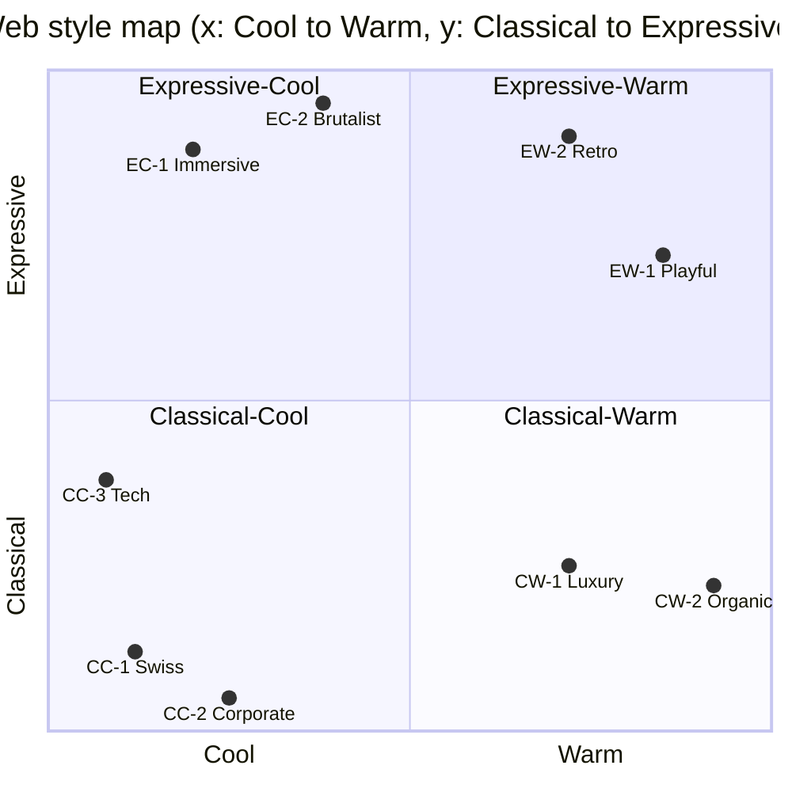

# Taxonomy: the justified style map

> In short: every web aesthetic in this library is placed on **two primary axes**: *how* it pleases (Classical order vs Expressive originality) and *what it signals about the brand* (Cool competence vs Warm intent). Four **secondary dials** (Density, Motion, Ornament, Contrast) then tune it. That gives 4 quadrants and 9 styles.

Paper references are by author and year. Full citations are in `academic-findings.md` and `bibliography.md`.

---

## 1. Why these two primary axes

### Axis 1: Classical ↔ Expressive (aesthetic mode)
**Source: Lavie & Tractinsky (2004).** In four studies (n = 125, 212, 145 and 384, with exploratory and then confirmatory factor analysis), users' aesthetic judgments of websites came out in two correlated but distinct factors:

| Classical (5 items) | Expressive (5 items) |
|---|---|
| aesthetic, pleasant, **clear**, **clean**, **symmetric** | **creative**, **fascinating**, **original**, **sophisticated**, uses **special effects** |

Why it is the right primary axis:
1. **It came from the data.** It was not imposed by the researchers ("we began this investigation with no conjecture", p. 287).
2. **It predicts usability.** Perceived usability correlates much more with classical aesthetics. This gives a practical rule: *the further a style moves toward Expressive, the more deliberately it must protect a classical skeleton for navigation and tasks.*
3. **It matches art history and environmental aesthetics.** Classical corresponds to Nasar's *visual clarity*, and Expressive to *visual richness* (Romanticism vs Classicism).
4. **It agrees with VisAWI** (Moshagen & Thielsch, 2010): *Simplicity* ≈ classical, *Diversity* ≈ expressive. The other two VisAWI facets are *Colourfulness*, which feeds Axis 2, and *Craftsmanship*, which is a universal quality floor rather than an axis.
5. **It frames the novelty problem.** Berlyne (1971), Hekkert et al. (2003, MAYA) and Tuch et al. (2012) show that preference rises with typicality *and* novelty, and falls with excess complexity. Classical styles maximise typicality and fluency (Reber et al., 2004). Expressive styles spend novelty but must stay "acceptable".

### Axis 2: Cool ↔ Warm (temperature)
Lavie & Tractinsky do not have a colour or temperature factor. Three independent research lines justify adding one:

| Research line | What it gives the axis |
|---|---|
| **Colour emotion**: Ou et al. (2004) | *Colour heat* (warm–cool) is one of three basic colour-emotion factors and can be computed from hue angle, lightness and chroma. This is the **perceptual** definition. |
| **Social cognition**: Fiske, Cuddy & Glick (2007); Kervyn, Fiske & Malone (2012); Aaker, Vohs & Mogilner (2010) | People and brands are judged on **warmth** (good intent, friendliness) and **competence** (ability). Warmth is judged first. Nonprofits default to warm, for-profits to competent. This is the **semantic** definition. |
| **Brand personality and colour**: Aaker (1997); Labrecque & Milne (2012) | Blue maps to competence, red and yellow to excitement and sincerity. Saturation and value amplify traits. This links temperature to **brand strategy**. |

So in this library **Cool** means: signals *competence* (precise, rational, technical, distant), uses blue-tinted or neutral hues, lower chroma, sharp geometry and grotesk or mono type. **Warm** means: signals *intent and humanity* (inviting, emotional, tactile), uses yellow, red or earth-tinted hues, organic shapes, serifs or rounded sans, texture and people.

> Caution: the embodied "physical warmth → social warmth" priming effect (Williams & Bargh, 2008) **failed to replicate** (Chabris et al., 2019). The axis rests on colour-emotion and social-perception evidence, not on priming.

### Why the axes are (nearly) orthogonal
Seckler, Opwis & Tuch (2015) varied **structure** and **colour** separately. Structure mostly moved the *simplicity* facet, and colour mostly moved *colourfulness*. Structure (Axis 1) and colour and temperature (Axis 2) can therefore be tuned independently. This is why a Swiss grid can be cool (CC-1) or warm (CW-1 luxury editorial), and why WebGL experiments can be cold chrome (EC-1) or a warm candy-coloured toybox (EW-1).

---

## 2. Secondary axes (scored 1–5 in every README)

| Axis | 1 → 5 | Evidence | Practical knobs |
|---|---|---|---|
| **Density** | airy → dense | Visual complexity lowers first-impression appeal (Tuch et al., 2009, 2012; Reinecke et al., 2013; Michailidou et al., 2008). The optimum shifts with audience (Reinecke & Gajos, 2014) and with return visits (Berlyne, 1970). | Elements per viewport, whitespace ratio, section padding (`clamp(4rem, 10vw, 10rem)` for airy, `2rem` for dense), number of columns |
| **Motion** | static → kinetic | Expressive "special effects" item (Lavie & Tractinsky, 2004); Awwwards Developer criteria include animations and transitions; WCAG 2.3.3 and `prefers-reduced-motion` | Easing curve, duration (150–250 ms UI, 600–1200 ms cinematic), scroll-linked vs triggered, WebGL yes/no |
| **Ornament** | bare → decorated | Nasar's *visual richness* (cited in Lavie & Tractinsky, 2004); embellishment aids memory without hurting comprehension (Bateman et al., 2010); Henderson et al. (2004) "elaborate/flourish" type dimensions | Illustration, grain and noise, borders, stickers, decorative type, patterns |
| **Contrast** | soft → hard | Fluency increases with figure-ground contrast (Reber et al., 1998, 2004); readability (Hall & Hanna, 2004); WCAG 1.4.3 | Value range of the palette, scale jumps in type (ratio 1.2 vs 1.618), hard vs soft shadows, black vs off-black |

*Contrast* here means **design contrast** (scale, weight and value jumps), not text contrast. Text contrast must meet WCAG AA in every style.

---

## 3. The map

```
                               EXPRESSIVE
                (creative · original · fascinating · special effects)
                                   ▲
                                   │
     EC-2 Brutalist-Raw            │            EW-2 Retro-Nostalgic
        (raw HTML, oversized       │              (Y2K, 70s/80s, riso,
         type, anti-design)        │               pixel, vintage print)
                                   │
   EC-1 Immersive-Experimental     │       EW-1 Playful-Illustrative
     (WebGL, shaders, scroll       │         (illustration, mascots,
      storytelling)                │          bright colour, bounce)
                                   │
 COOL ◄────────────────────────────┼────────────────────────────► WARM
 (competence · precise · rational) │      (intent · human · tactile · inviting)
                                   │
     CC-3 Tech-Product             │            CW-1 Luxury-Refined
       (dark UI, glow, bento)      │              (serif, whitespace,
                                   │               slow motion)
   CC-1 Swiss-Editorial-Minimal    │
       (grid, grotesk, white)      │            CW-2 Warm-Organic
                                   │              (earth tones, texture,
     CC-2 Corporate-Trust          │               soft shapes)
       (institutional clarity)     │
                                   ▼
                               CLASSICAL
                (clear · clean · symmetric · pleasant)
```

Approximate coordinates (1 = Classical or Cool, 5 = Expressive or Warm). Style folders may refine these in their READMEs.

| Style | Classical→Expressive | Cool→Warm | Density | Motion | Ornament | Contrast |
|---|---|---|---|---|---|---|
| CC-1 Swiss-Editorial-Minimal | 1.5 | 1.5 | 2 | 1–2 | 1 | 4 |
| CC-2 Corporate-Trust | 1 | 2 | 3 | 1–2 | 1–2 | 2–3 |
| CC-3 Tech-Product | 2.5 | 1 | 3 | 3 | 2 | 4 |
| CW-1 Luxury-Refined | 2 | 4 | 1 | 2–3 | 2 | 3 |
| CW-2 Warm-Organic | 2 | 5 | 2 | 2 | 3 | 2 |
| EC-1 Immersive-Experimental | 4.5 | 1.5–2 | 2 | 5 | 3 | 4 |
| EC-2 Brutalist-Raw | 5 | 2.5 | 4 | 2 | 1–2 (bare but loud) | 5 |
| EW-1 Playful-Illustrative | 4 | 4.5 | 3 | 4 | 4–5 | 3–4 |
| EW-2 Retro-Nostalgic | 4.5 | 4 | 4 | 3 | 5 | 4 |

Mermaid version, for renderers that support quadrant charts:



---

## 4. Purpose → style matrix

✅ strong fit · ➖ possible with care · ❌ avoid. The reasoning combines **prototypicality** (Tuch et al., 2012: match genre expectations), **warmth vs competence** needs (Aaker et al., 2010; Fiske et al., 2007) and **audience complexity tolerance** (Reinecke & Gajos, 2014).

| Purpose | CC-1 Swiss | CC-2 Corp | CC-3 Tech | CW-1 Lux | CW-2 Organic | EC-1 Immersive | EC-2 Brutal | EW-1 Playful | EW-2 Retro | Best pick and why |
|---|---|---|---|---|---|---|---|---|---|---|
| **Portfolio (designer/dev)** | ✅ | ❌ | ➖ | ➖ | ➖ | ✅ | ✅ | ➖ | ✅ | The audience is experts who reward originality (Leder et al., 2004). Expressive works. Swiss works for "the work speaks". |
| **Creative agency** | ✅ | ❌ | ➖ | ➖ | ❌ | ✅ | ✅ | ➖ | ➖ | Competing for Awwwards and FWA attention: Immersive or Brutalist. Keep a classical case-study grid. |
| **Corporate / finance** | ✅ | ✅ | ➖ | ➖ | ❌ | ❌ | ❌ | ❌ | ❌ | Competence and trust: classical aesthetics track perceived usability (Lavie & Tractinsky, 2004), blue means competence (Labrecque & Milne, 2012). Add one warmth cue. |
| **SaaS / dev tools** | ➖ | ➖ | ✅ | ❌ | ❌ | ➖ | ➖ | ➖ | ❌ | The genre prototype is strong (dark UI, product as hero). Novelty goes into the product visual, not the IA. |
| **E-commerce: fashion/luxury** | ✅ | ❌ | ❌ | ✅ | ➖ | ➖ | ➖ | ❌ | ➖ | Sophistication = dark or desaturated colour, serif, space (Aaker, 1997; Labrecque & Milne, 2012). Checkout stays classical. |
| **E-commerce: consumer** | ❌ | ➖ | ❌ | ❌ | ✅ | ❌ | ❌ | ✅ | ➖ | Sincerity and excitement drive warmth. Colour appeal drives trust and loyalty (Cyr et al., 2010). Keep the shop prototype. |
| **Editorial / media** | ✅ | ➖ | ❌ | ✅ | ➖ | ➖ | ✅ | ❌ | ➖ | Reading comfort first (measure 60–75ch; Dyson & Haselgrove, 2001). Expression lives in headlines and art direction. |
| **Nonprofit / NGO** | ➖ | ➖ | ❌ | ❌ | ✅ | ➖ | ❌ | ✅ | ❌ | Nonprofits read as warm but not competent, so add hard data (Aaker et al., 2010). Immersive works for one-off campaigns. |
| **Event / festival** | ❌ | ❌ | ➖ | ➖ | ➖ | ✅ | ✅ | ✅ | ✅ | Short-lived, returning young audiences tolerate high arousal (Berlyne, 1971; Djamasbi et al., 2010). Practical info (dates, tickets) stays classical. |
| **Personal blog** | ✅ | ❌ | ➖ | ➖ | ✅ | ❌ | ✅ | ➖ | ✅ | Identity expression (hedonic identification; Hassenzahl, 2004). Readability is non-negotiable. |
| **Restaurant / hospitality** | ❌ | ❌ | ❌ | ✅ | ✅ | ➖ | ➖ | ➖ | ✅ | Warm, sensory, tactile. Menu, hours and booking must be found within 1 click. |
| **Education** | ✅ | ✅ | ➖ | ❌ | ✅ | ❌ | ❌ | ✅ | ❌ | Clarity and low complexity for learning. Playful for children's brands. Pair with competence cues (accreditation). |

---

## 5. Brand personality → style

Based on Aaker's (1997) five dimensions, the colour mappings of Labrecque & Milne (2012), the typeface personas of Brumberger (2003a: elegance, friendliness, directness) and the typeface impressions of Henderson et al. (2004: reassuring, engaging, pleasing, prominent).

| Aaker dimension (facets) | Primary style(s) | Secondary | Colour logic | Type persona | Motion and ornament |
|---|---|---|---|---|---|
| **Competence** (reliable, intelligent, successful) | CC-2 Corporate-Trust, CC-3 Tech-Product | CC-1 Swiss | Blue and neutral, mid value, low-to-mid chroma | *Directness*, *reassuring*: neutral grotesk, harmonious, moderate weight | Low ornament, functional motion (150–250 ms) |
| **Sophistication** (upper-class, charming, glamorous) | CW-1 Luxury-Refined | CC-1 Swiss, EC-1 Immersive | Dark, low value, desaturated, black/ivory/gold or deep jewel tones | *Elegance*: high-contrast serif, light weights, wide tracking for caps | Slow, eased motion (600–1200 ms), minimal ornament, generous space |
| **Excitement** (daring, spirited, imaginative, up-to-date) | EC-1 Immersive, EC-2 Brutalist, EW-1 Playful | EW-2 Retro, CC-3 Tech | Red, orange, electric accents, high chroma | *Prominent*, *engaging*: heavy or compressed display, variable fonts | High motion, novel interactions, 1–3 MAYA "surprises" |
| **Sincerity** (down-to-earth, honest, wholesome, cheerful) | CW-2 Warm-Organic, EW-1 Playful | CC-1 Swiss (honest simplicity) | Yellow, warm neutrals, soft greens, high value | *Friendliness*, *pleasing*: rounded sans, soft serif, natural | Gentle motion, hand-made textures, real photography |
| **Ruggedness** (outdoorsy, tough) | CW-2 Warm-Organic (earthy), EC-2 Brutalist (tough) | EW-2 Retro (workwear, vintage print) | Browns, olives, dark low value, anchored to appealing referents such as wood, leather and landscape (Palmer & Schloss, 2010) | Slab serif, condensed grotesk, stencil | Texture and grain, hard edges, little bounce |

**Two-dimension brands** (the common case): pick the quadrant from the *primary* dimension, then borrow **one** token family from the secondary style. For example, "competent + sincere" bank → CC-2 with CW-2's warm neutrals and photography. "Sophisticated + exciting" fashion label → CW-1 with one EC-1 WebGL moment in the hero.

---

## 6. How the taxonomy maps to Kansei engineering

Kansei engineering (Nagamachi, 1995, 2002; Schütte et al., 2004) connects a **semantic space** (emotion words) to a **property space** (design parameters). This library is a hand-built Kansei model for the web:

```
Semantic space                                  Property space
───────────────                                 ──────────────
Classical ↔ Expressive  (Lavie & Tractinsky) ─┐
Cool ↔ Warm (Ou et al.; Fiske et al.)        ├──►  Density · Motion · Ornament · Contrast
Aaker personality traits                     │     + tokens.css (type, colour, space,
Target Kansei words per brand ("calm,        ┘       radius, shadow, easing)
 precise, premium")
```

**How to use it in a prompt (category-classification KE):**
1. Brand brief → 3–5 *Kansei words* and 1–2 *Aaker dimensions*.
2. Kansei words → quadrant (axis 1 × axis 2) → style folder.
3. Style folder → secondary-axis scores → `tokens.css`.
4. Validate: the self-critique rubric uses Lavie & Tractinsky's 10 items + VisAWI-S's 4 items + the Kansei words.

---

## 7. Practical decision procedure (for the master prompt)

1. **What must the visitor believe first: "they mean well" (warm) or "they're capable" (cool)?** → Axis 2.
2. **Does the audience reward conformity (task, trust, transaction) or originality (culture, recruiting, awards)?** → Axis 1. When it is transactional, stay ≤ 2.5 on Expressive, or keep transactional pages classical.
3. **How complex and colourful can this audience take?** (Reinecke & Gajos, 2014) → Density and Contrast.
4. **Pick the style folder, keep the genre's page prototype, and choose 2–3 uniqueness levers** (MAYA: Hekkert et al., 2003).
5. **Add the missing half of warmth × competence** with one deliberate cue.
6. **Run the critique**: 10 Lavie & Tractinsky items, VisAWI-S, WCAG AA, Core Web Vitals.
